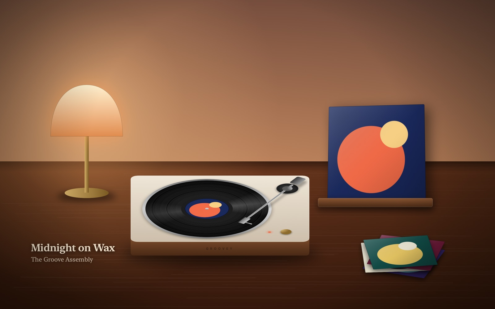
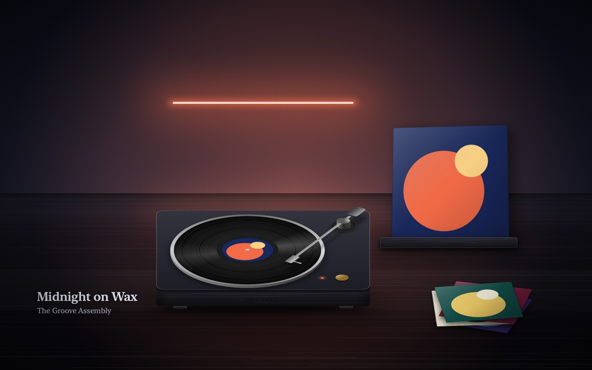
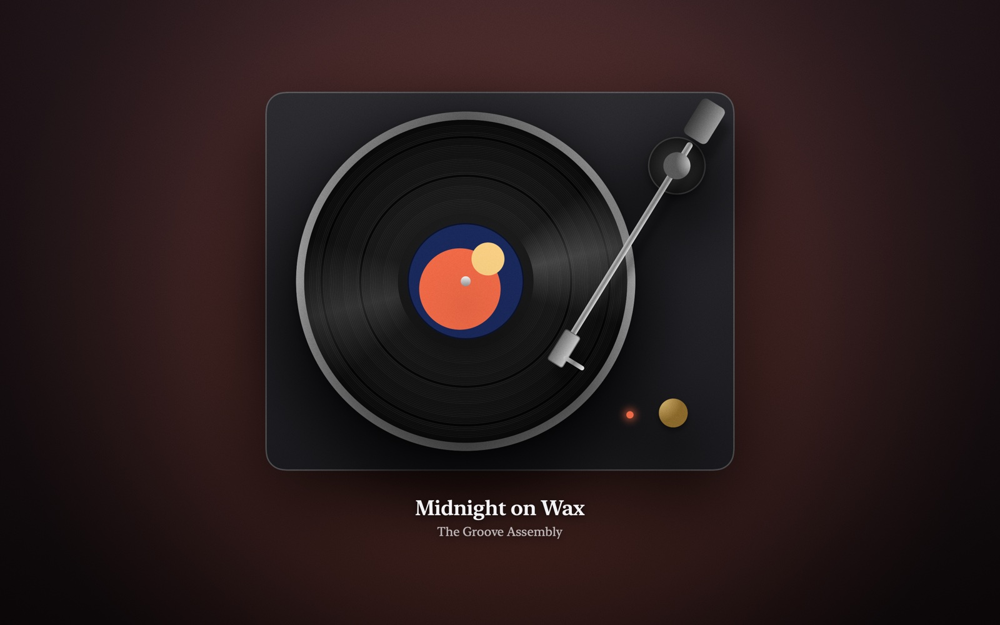

# Groovey

A turntable for your Mac desktop. Groovey sits between your wallpaper and your desktop icons and shows whatever you are listening to as a record on a turntable: the cover goes on a stand, the label spins, the tonearm follows the song, and the last few albums pile up on the desk.

Free, open source, no account, no tracking.



| Night | Minimal |
|---|---|
|  |  |

## Features

- Works with Spotify, Apple Music, and anything else that shows up in Control Center's Now Playing (browsers included).
- Three scenes: **Warm Room**, **Night** and **Minimal**. The lighting picks up the colours of the album cover.
- The tonearm tracks the song's position; the record stops when you pause.
- A pile of recently played albums. Click it on the desktop to see the list.
- Every display, every Space.
- Stays out of the way: no Dock icon, and it stops animating when the desktop is covered, the music is paused, or the display sleeps. While a record spins it uses a fraction of a percent of CPU.
- Menu bar controls: scene, music source, hide when paused, launch at login.
- Built-in updates.
- English and Turkish.

## Install

Requires macOS 14 Sonoma or later (Apple Silicon or Intel).

1. Download `Groovey-x.y.z.dmg` from the [latest release](https://github.com/ozturkbasrii/groovey/releases/latest).
2. Open it and drag **Groovey** into **Applications**.
3. Open Groovey. It appears as a disc icon in the menu bar.

Groovey is signed with a Developer ID and notarized by Apple, so it opens without warnings. Version 0.2.0 and earlier were not; if you still have one of those, download the latest release once by hand, since they cannot update themselves to it.

## Build from source

You need Xcode 16 or later and [XcodeGen](https://github.com/yonaskolb/XcodeGen).

```bash
brew install xcodegen
git clone https://github.com/ozturkbasrii/groovey.git
cd groovey
scripts/build.sh install   # builds, copies to /Applications, launches
```

To work on it in Xcode, run `xcodegen generate` and open `Groovey.xcodeproj`. Run the tests with:

```bash
xcodebuild -project Groovey.xcodeproj -scheme Groovey -derivedDataPath build test
```

A debug build can render every scene to PNG files, which is handy when changing the drawing code:

```bash
GROOVEY_SNAPSHOT=/tmp/groovey-scenes build/Build/Products/Debug/Groovey.app/Contents/MacOS/Groovey
```

## How it works

**The window.** Each display gets a borderless window one level above the wallpaper and below the desktop icons, present on all Spaces. It ignores the mouse, so your desktop behaves as usual.

**Now Playing.** Since macOS 15.4, Apple only lets its own programs read the system Now Playing session. Groovey bundles [mediaremote-adapter](https://github.com/ungive/mediaremote-adapter), which runs inside the system's `/usr/bin/perl` and streams the session as JSON. If that ever stops working, Groovey falls back to asking Spotify and Music directly over AppleScript; macOS will ask for your permission the first time.

**Drawing.** Everything on screen is drawn in code with SwiftUI; there are no image assets. Scenes are composed on a 1440×900 stage that scales to any display. The spinning label is a Core Animation layer, so the rotation runs in the window server instead of redrawing the scene.

**Clicking the pile.** A window under the desktop icons never receives clicks, so Groovey watches for mouse clicks globally and checks whether one landed on the pile with nothing else on top. It does not read what you click elsewhere and needs no Accessibility or Screen Recording permission.

## Privacy

Groovey has no accounts, analytics or telemetry. Your listening history (the last 20 songs and their covers) is stored only on your Mac, in `~/Library/Application Support/Groovey`. The app goes online only to check for updates from this repository and, in the AppleScript fallback, to fetch the cover image Spotify points to.

## Project layout

```
Groovey/App          app entry, menu, settings
Groovey/Desktop      desktop-level windows, spinning label layer
Groovey/NowPlaying   track model, MediaRemote and AppleScript sources
Groovey/Scene        the drawing code and themes
Groovey/History      recently played store and panel
Vendor/              mediaremote-adapter (BSD 3-Clause)
scripts/             build, DMG, release and icon scripts
```

## Türkçe

Groovey, dinlediğin müziği masaüstünde bir pikap sahnesi olarak gösteren ücretsiz ve açık kaynak bir macOS uygulamasıdır. Duvar kâğıdının üstünde, masaüstü simgelerinin altında durur. Albüm kapağı standa konur, plağın etiketi döner, pikap kolu şarkının ilerleyişini izler ve son dinlediğin albümler masada birikir.

**Kurulum:** [Son sürümden](https://github.com/ozturkbasrii/groovey/releases/latest) DMG dosyasını indir, Groovey'yi Uygulamalar klasörüne sürükle ve aç. Uygulama Developer ID ile imzalı ve Apple'ın noter onayından geçmiş olduğu için uyarısız açılır. 0.2.0 ve öncesini kurduysan son sürümü bir kez elle indirmen gerekir, çünkü o sürümler kendilerini otomatik güncelleyemez.

Spotify, Apple Music ve Denetim Merkezi'ndeki "Şu An Çalan" bölümünde görünen tüm uygulamalarla çalışır. Hesap, reklam ya da veri toplama yoktur.

## Credits and licence

Groovey is released under the [MIT licence](LICENSE). It bundles [mediaremote-adapter](https://github.com/ungive/mediaremote-adapter) by Jonas van den Berg (BSD 3-Clause) and [Sparkle](https://sparkle-project.org) (MIT); see [THIRD_PARTY_LICENSES.md](THIRD_PARTY_LICENSES.md).

Groovey is an independent project and is not affiliated with Apple, Spotify or any other music service.
